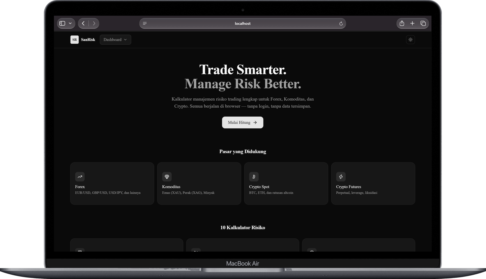
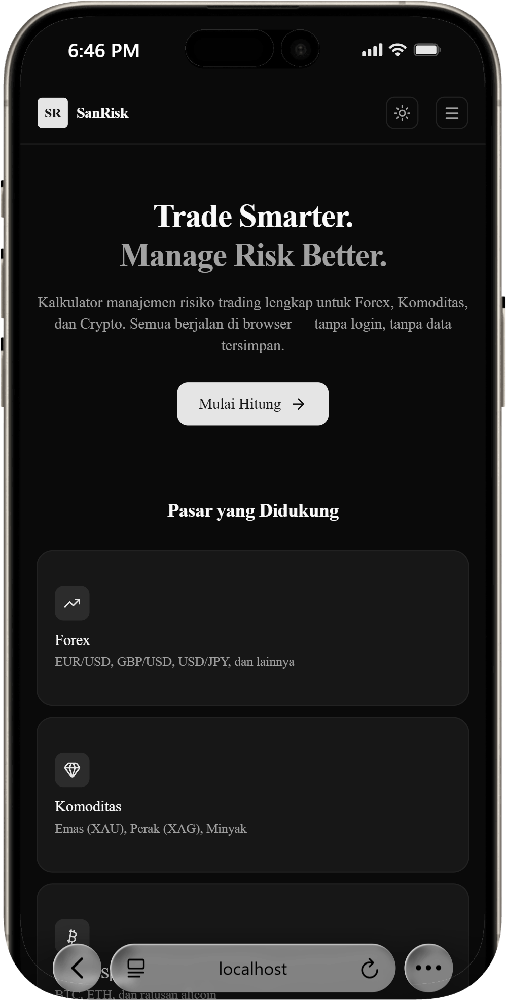

# SanRisk – Trading Risk Management Toolkit

A collection of trading risk management calculators for Forex, Commodities, and Cryptocurrency (Spot & Futures).

*Kumpulan kalkulator manajemen risiko trading untuk Forex, Komoditas, dan Cryptocurrency (Spot & Futures).*

## Preview | Pratinjau

### Desktop View | Tampilan Desktop

The desktop interface of SanRisk, featuring a complete set of trading risk management tools.

*Tampilan desktop SanRisk yang menyediakan berbagai perangkat manajemen risiko trading.*



### Mobile View | Tampilan Mobile

A responsive interface designed to provide a comfortable experience across different screen sizes.

*Tampilan responsif yang dirancang agar nyaman digunakan pada berbagai ukuran layar.*



## Description | Deskripsi

SanRisk is a web-based trading risk management toolkit designed to help traders calculate position sizes, manage potential losses, evaluate risk-to-reward ratios, and understand trading costs.

*SanRisk adalah perangkat manajemen risiko trading berbasis web yang membantu trader menghitung ukuran posisi, mengelola potensi kerugian, mengevaluasi rasio risiko terhadap keuntungan, dan memahami biaya trading.*

The application supports Forex, Commodities, and Cryptocurrency markets, including Spot and Futures trading. All calculations are performed locally in the browser without requiring an account or login.

*Aplikasi ini mendukung pasar Forex, Komoditas, dan Cryptocurrency, termasuk trading Spot dan Futures. Seluruh perhitungan dilakukan secara lokal di browser tanpa memerlukan akun atau login.*

## Features | Fitur

- **Position Size Calculator** – Calculate position sizes based on account balance, risk percentage, and stop-loss distance.  
  *Menghitung ukuran posisi berdasarkan saldo akun, persentase risiko, dan jarak stop loss.*

- **Risk per Trade** – Calculate potential loss and risk percentage for each trade.  
  *Menghitung potensi kerugian dan persentase risiko pada setiap transaksi.*

- **Stop Loss & Take Profit** – Determine stop-loss and take-profit price levels for trading positions.  
  *Menentukan level harga stop loss dan take profit untuk posisi trading.*

- **Risk/Reward Calculator** – Evaluate the relationship between potential risk and reward.  
  *Mengevaluasi perbandingan antara potensi risiko dan keuntungan.*

- **Max Drawdown** – Calculate maximum drawdown, drawdown percentage, and recovery requirements.  
  *Menghitung maximum drawdown, persentase penurunan, dan kebutuhan pemulihan.*

- **Risk Exposure** – Monitor total trading risk and remaining risk budget.  
  *Memantau total risiko trading dan sisa anggaran risiko.*

- **Leverage & Margin** – Calculate required margin, margin level, and free margin.  
  *Menghitung margin yang dibutuhkan, margin level, dan free margin.*

- **Trading Fee Calculator** – Estimate trading fees and their impact on profit and loss.  
  *Memperkirakan biaya trading dan dampaknya terhadap keuntungan maupun kerugian.*

- **Funding Fee Calculator** – Calculate funding fees for cryptocurrency futures positions.  
  *Menghitung biaya funding untuk posisi futures cryptocurrency.*

- **Scenario Simulator** – Simulate trading outcomes and evaluate trading expectancy.  
  *Mensimulasikan hasil trading dan mengevaluasi ekspektasi strategi.*

## Technology Stack | Teknologi

- **Next.js** – React framework for building the web application.
- **React** – Component-based user interface library.
- **TypeScript** – Static typing for more reliable code.
- **Tailwind CSS** – Utility-first styling framework.
- **Lucide React** – Icon library.
- **Zustand** – Lightweight state management.
- **Decimal.js** – Precise decimal arithmetic for financial calculations.

*Teknologi yang digunakan meliputi Next.js, React, TypeScript, Tailwind CSS, Lucide React, Zustand, dan Decimal.js.*

## Project Structure | Struktur Project

```text
sanrisk/
├── app/
│   ├── drawdown/
│   ├── funding-fee/
│   ├── leverage-margin/
│   ├── position-size/
│   ├── risk-calculator/
│   ├── risk-exposure/
│   ├── risk-reward/
│   ├── scenario-simulator/
│   ├── stop-loss-take-profit/
│   ├── trading-fee/
│   ├── globals.css
│   ├── layout.tsx
│   └── page.tsx
├── components/
│   └── ui/
├── lib/
│   └── calculators/
├── public/
├── store/
├── assets/
│   └── images/
│       ├── preview1.png
│       └── mobile-preview.png
├── .gitignore
├── package.json
└── README.md
```

*Struktur direktori utama SanRisk yang memisahkan halaman aplikasi, komponen antarmuka, logika kalkulasi, aset gambar, dan state management.*

## Installation and Run | Instalasi dan Menjalankan

**1. Clone the repository**

```bash
git clone https://github.com/USERNAME/sanrisk.git
```

**2. Navigate to the project directory**

```bash
cd sanrisk
```

**3. Install dependencies**

```bash
npm install
```

**4. Run the development server**

```bash
npm run dev
```

Open [http://localhost:3000](http://localhost:3000) in your browser.

*Buka alamat tersebut melalui browser untuk menjalankan SanRisk secara lokal.*

**5. Build for production**

```bash
npm run build
```

**6. Start the production server**

```bash
npm run start
```

## Usage | Cara Penggunaan

1. Select the calculator you want to use.
2. Choose the relevant trading market or instrument.
3. Enter the required trading parameters.
4. Review the calculated results.

*Pilih kalkulator yang ingin digunakan, tentukan pasar atau instrumen trading, masukkan parameter yang diperlukan, kemudian tinjau hasil perhitungannya.*

## Calculation Notes | Catatan Perhitungan

SanRisk uses different calculation approaches depending on the selected market and instrument.

*SanRisk menggunakan pendekatan perhitungan yang berbeda sesuai pasar dan instrumen yang dipilih.*

- **Forex:** Position sizing is based on risk amount, stop-loss distance in pips, and pip value per lot.
- **Commodities:** Position sizing uses risk amount, stop-loss distance in ticks, and tick value.
- **Crypto Spot:** Position sizing considers stop-loss distance and estimated trading fees.
- **Crypto Futures:** Position sizing is based on risk amount and stop-loss price distance.

*Forex menggunakan nilai pip, Komoditas menggunakan nilai tick, Crypto Spot memperhitungkan estimasi biaya transaksi, sedangkan Crypto Futures menggunakan jarak harga stop loss.*

## Limitations | Batasan

- SanRisk is a calculation tool, not a trading platform or financial advisory service.  
  *SanRisk merupakan alat bantu perhitungan, bukan platform trading atau layanan konsultasi keuangan.*

- Calculation results depend on the accuracy of the input values.  
  *Hasil perhitungan bergantung pada keakuratan nilai yang dimasukkan.*

- Actual trading fees, spreads, slippage, contract specifications, and broker rules may affect real trading results.  
  *Biaya transaksi, spread, slippage, spesifikasi kontrak, dan aturan broker dapat memengaruhi hasil trading sebenarnya.*

- The results are estimates and should be verified against your broker or exchange specifications.  
  *Hasil perhitungan merupakan estimasi dan perlu disesuaikan dengan spesifikasi broker atau exchange yang digunakan.*

## License | Lisensi

Copyright © 2026 SanRisk. All Rights Reserved.

SanRisk is proprietary software. The source code, design, and related materials may not be copied, modified, redistributed, or used to create derivative works without prior written permission from the copyright holder.

*SanRisk merupakan perangkat lunak dengan hak cipta eksklusif. Kode sumber, desain, dan materi terkait tidak boleh disalin, dimodifikasi, didistribusikan ulang, atau digunakan untuk membuat karya turunan tanpa izin tertulis sebelumnya dari pemegang hak cipta.*